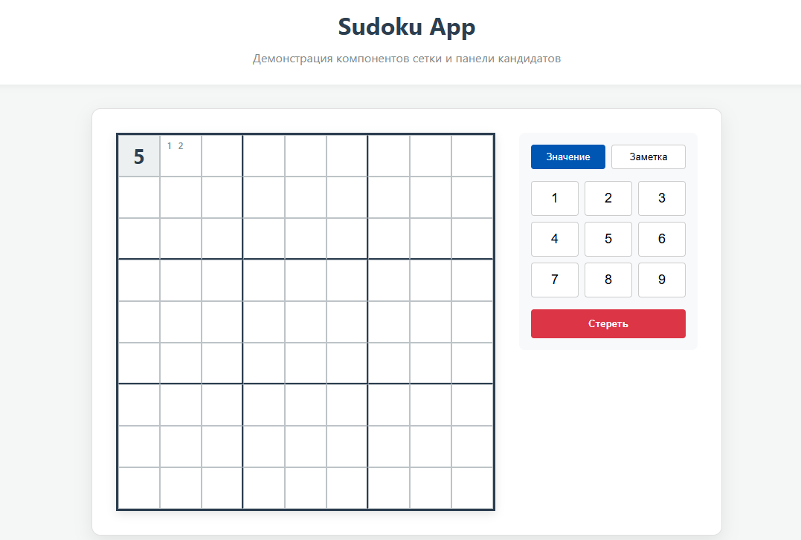
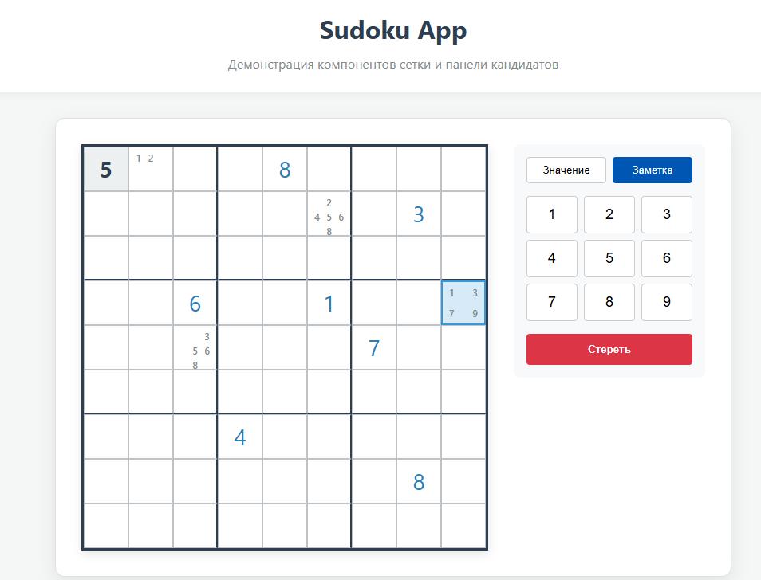

```markdown
# Sudoku UI Library & Demo App

Учебный проект, состоящий из двух частей: библиотеки UI-компонентов для игры в Судоку и демонстрационного веб-приложения, использующего эту библиотеку.

## 📋 Описание проекта

Проект разделен на два независимых пакета (монорепозиторий):

1. **`ui-library`** — React-библиотека компонентов, написанная на TypeScript. 
   - Не использует сторонние UI-библиотеки.
   - Стилизация выполнена через CSS Modules.
   - Покрытие тестами (Jest + React Testing Library) — **100%**.
   - Компоненты:
     - `SudokuGrid` — сетка 9x9 с поддержкой значений и заметок (кандидатов).
     - `CandidatePanel` — панель выбора цифры и переключения режимов «Значение / Заметка».
2. **`frontend`** — демонстрационное приложение (Vite + React), показывающее работу библиотеки в реальном сценарии игры.

## 🚀 Инструкция по запуску

Для запуска проекта вам понадобится Node.js (версия 18+).

### Шаг 1. Сборка библиотеки компонентов

Перейдите в папку библиотеки, установите зависимости и соберите её:

```bash
cd ui-library
npm install
npm run build
```

### Шаг 2. Запуск демонстрационного приложения

Перейдите в папку фронтенда, установите зависимости и запустите dev-сервер:

```bash
cd ../frontend
npm install
npm run dev
```

После этого приложение будет доступно по адресу, указанному в консоли (обычно `http://localhost:5173`).

## 🎮 Как играть

1. Кликните по пустой ячейке на сетке — она подсветится.
2. На панели справа выберите режим:
   - **Значение**: цифра запишется в ячейку крупным шрифтом.
   - **Заметка**: цифра запишется мелким шрифтом в угол ячейки (как карандашом).
3. Кнопка **Стереть** очищает выбранную ячейку от значений и заметок.
4. Изначально заданные цифры (серый фон) редактировать нельзя.

## 🧪 Тестирование и проверка кода

В обоих проектах настроены скрипты для проверки качества кода:

```bash
# Запуск тестов
npm run test

# Запуск тестов с отчетом о покрытии
npm run test:coverage

# Проверка кода линтером (ESLint)
npm run lint

# Автоматическое исправление ошибок линтера
npm run lint:fix

# Сборка production-версии
npm run build
```

## 📸 Примеры работы приложения

### Общий вид игры


### Режим заметок (кандидатов)


## 🛠️ Технологии

- **React 19**
- **TypeScript**
- **Vite** (сборщик)
- **Jest + React Testing Library** (тестирование)
- **ESLint** (статический анализ кода)
- **CSS Modules** (изоляция стилей)

## 📂 Структура проекта

```text
solutions/student-14/
├── ui-library/          # Библиотека компонентов
│   ├── src/
│   │   ├── SudokuGrid/
│   │   ├── CandidatePanel/
│   │   └── index.ts
│   └── package.json
├── frontend/            # Демонстрационное приложение
│   ├── src/
│   │   ├── App.tsx
│   │   └── main.tsx
│   └── package.json
├── screenshots/         # Скриншоты для README
│   ├── image0.png
│   └── image.png
└── README.md
```